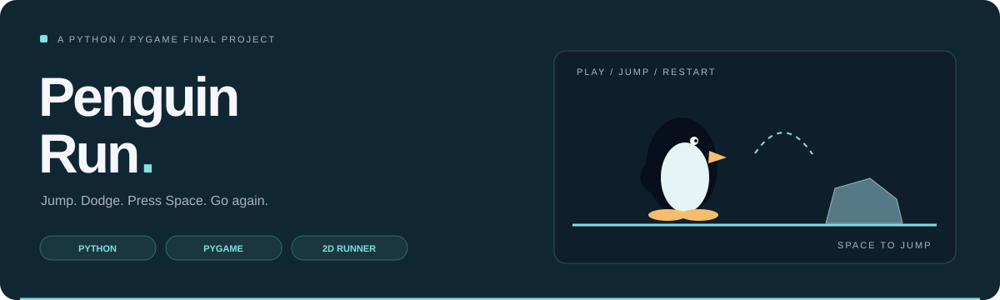
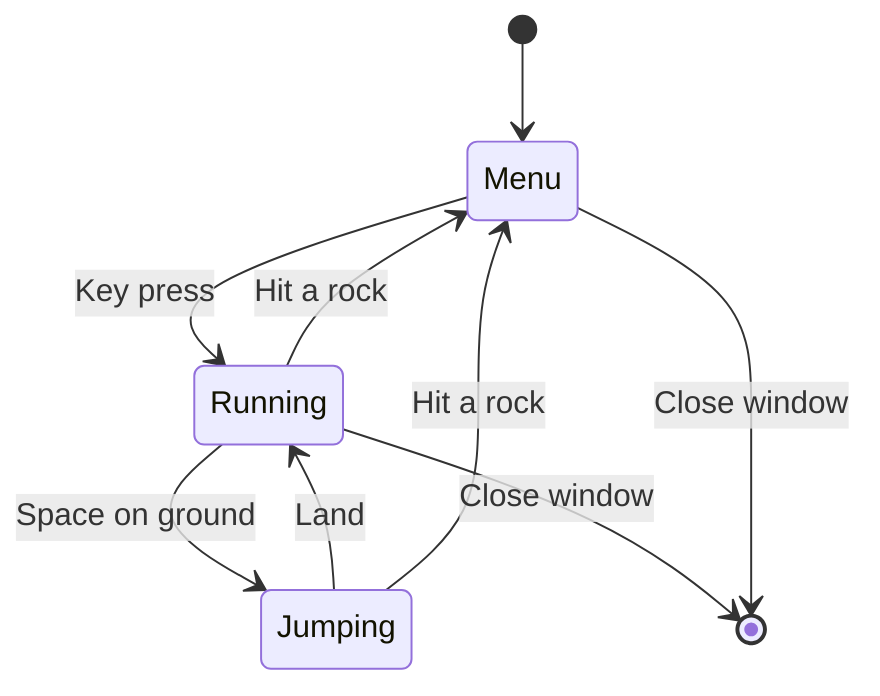

<div align="center">

**One penguin. Incoming rocks. Your spacebar.**

[Game source](penguinrun.py) · [Sprites](sprite/) · [Play locally](#02--play-locally)

</div>

---

## 01 / Meet Penguin Run

A small endless-runner game built with **Python and Pygame** for a graphics and data structures final project. An animated penguin stays on the left while rocks move across the screen. Time a jump to avoid a collision; when you hit a rock, the menu tracks your deaths and lets you try again.

| The game | The implementation |
| --- | --- |
| Animated penguin | Two running sprite frames |
| Jump and land | Jump velocity, gravity, and ground state |
| Moving obstacles | Small and large rock classes |
| Collision detection | Pygame rectangles with adjusted hitboxes |
| Restart menu | Death counter and keyboard input |
| Display | 1000 × 500 window, capped at 60 FPS |

## 02 / Play locally

You need Python 3, pip, and a desktop environment that can open a Pygame window.

**The folder name and launch location matter.** Asset paths are hard-coded relative to a folder named `Final Project`. Clone using that name and launch from its parent directory:

```bash
git clone https://github.com/KaiAlexander-commits/Final-Project.git "Final Project"
python -m venv .venv
```

Activate the environment:

```bash
# macOS / Linux
source .venv/bin/activate

# Windows PowerShell
.venv\Scripts\Activate.ps1
```

Install Pygame and launch from the same parent directory:

```bash
python -m pip install pygame
python "Final Project/penguinrun.py"
```

## 03 / The controls

| Input | Action |
| --- | --- |
| Any key on the menu | Start or restart |
| Space during a run | Jump when on the ground |
| Close the window | Quit |

The opening menu advertises Space to start, though the implementation accepts any key.

## 04 / Behind the run



| Code | Responsibility |
| --- | --- |
| `Penguin` | Animation, jumping, and falling |
| `Obstacle` | Horizontal motion and drawing |
| `SmallSpike` / `LargeSpike` | Rock placement and size |
| `main()` | Input, drawing, obstacle updates, and collision checks |
| `menu()` | Start/restart screen and death count |

All gameplay code is in [penguinrun.py](penguinrun.py). The [sprite folder](sprite/) contains PNG assets and an Aseprite source file.

## 05 / Current edges

- The display tracks deaths; the `points` variable is not an implemented score system.
- Asset paths depend on the working directory shown above.
- Restarting calls the game loop from the menu; repeated restarts create nested calls.
- There is no automated test suite or dependency manifest.

This repository is a fork of [kaismith31/Final-Project](https://github.com/kaismith31/Final-Project); GitHub retains its fork relationship and history.

---

<div align="center">

**Jump. Miss the rock. Go again.**

[More projects](https://github.com/KaiAlexander-commits?tab=repositories)

</div>
